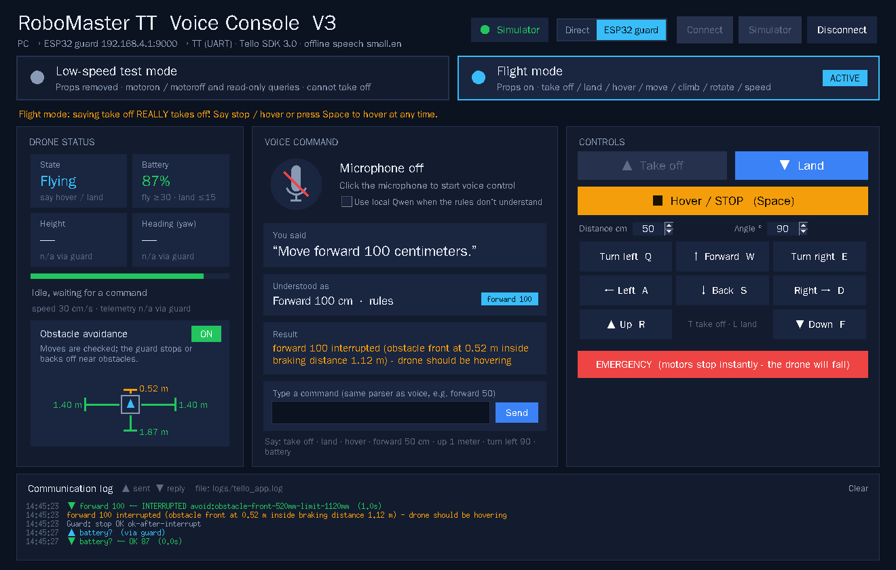
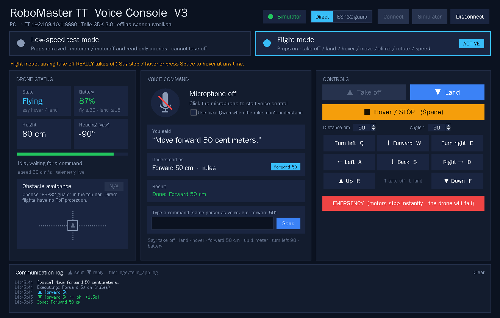
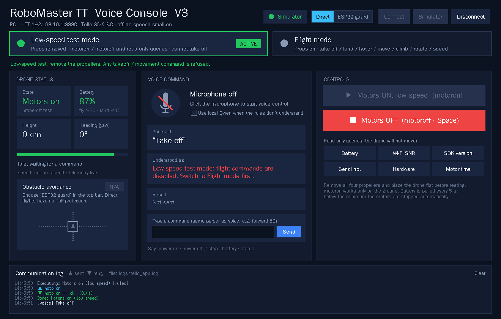

# RoboMaster TT Voice Console · V3

用英文语音控制大疆 **RoboMaster TT（Tello Talent）** 的桌面程序，配套运行在 TT 开源控制器（ESP32）上的
**四向 ToF 避障固件**。离线语音识别（Whisper small.en），所有指令都按 **Tello SDK 3.0** 规范检查后才发送。
图形界面可以切换「低速测试 / 正常飞行」两种模式，以及「直连 TT / 经 ESP32 避障」两种连接方式，避障可以随时开关。

*Offline English voice control for the DJI RoboMaster TT, plus ESP32 firmware that guards every move
with four VL53L0X ToF sensors. Two modes (props-off motor test / flight), two routes (direct / via the
ESP32 guard) and a live obstacle-avoidance switch.*



| 正常飞行（直连） | 低速测试 |
|---|---|
|  |  |

## 功能

- **两种模式**，空中或电机转动时不能切换：
  - **低速测试**（默认）：只能发送 `motoron` / `motoroff` 和只读查询，不可能起飞。
  - **正常飞行**：起飞、降落、悬停、六向移动、旋转、调速。切换时会弹窗确认桨叶和场地。
- **两种连接方式**（顶栏 *Direct* / *ESP32 guard*）：
  - **Direct**：电脑连 TT 的 `RMTT-xxxx` Wi-Fi，直接发 UDP 到 `192.168.10.1:8889`。不经过 ToF 传感器，没有避障。
  - **ESP32 guard**：电脑连 ESP32 的 `TT-ToF-Demo` Wi-Fi，ESP32 读四个 ToF 传感器，检查后通过 UART 转发给飞控。
- **避障开关**：经 ESP32 时，在界面上随时 ON / OFF。界面上的雷达图实时显示前后左右四个方向的距离。
  - 平移前按距离和速度检查是否撞墙，起飞和旋转前检查四周是否留有空间；
  - 运动中按接近速度动态计算刹车距离，进入后立即悬停；
  - 悬停时障碍物太近，会自动后退 20 cm。
- **离线英文语音**：支持英文数字词（fifty、one hundred twenty）和米 / 厘米单位。可选本地 Qwen 兜底（带锚定校验）。
- **键盘与按钮**：空格 = 悬停 / 停电机；W/S/A/D/R/F/Q/E 控制方向，T 起飞，L 降落。
- **模拟器**：两种连接方式都能用。ESP32 模拟器带一个 4.5 m × 3 m 的虚拟房间，不连硬件也能看到避障效果。

## 语音口令

| 说法（例） | SDK 指令 | 模式 |
|---|---|---|
| `take off` / `land` / `hover`（`stop`） | `takeoff` / `land` / `stop` | 飞行 |
| `move forward 50 centimeters` · `back 30` · `left 1.5 meters` | `forward 50` · `back 30` · `left 150` | 飞行 |
| `go up one meter` · `down 25` | `up 100` · `down 25` | 飞行 |
| `turn left 90 degrees` · `turn right` · `turn around` | `ccw 90` · `cw 90` · `cw 180` | 飞行 |
| `set speed to 40` | `speed 40` | 飞行 |
| `power on` / `power off`（`stop`） | `motoron` / `motoroff` | 低速测试 |
| `battery` · `status` | `battery?` · 本地状态 | 两者 |

含否定（*don't…*）、组合（*…and then…*）、一句里有多个口令（Whisper 提示词回声）的句子一律拒绝。

## 安全机制

- 每条指令都经过 SDK 3.0 白名单和范围检查（移动 20–500 cm、旋转 1–360°、速度 10–100）。
  另设室内单次移动上限 200 cm（`config.json` → `max_move_cm`）。PC 和 ESP32 各检查一次。
- 同一时间只执行一条指令，不排队；`stop` / `land` / `emergency` / `motoroff` 可以插队。
- SDK 回复没有 ID，所以超时的指令不重发。被打断后先用 `battery?` 重新对齐回复流。经 ESP32 时每个请求都带 ID。
- 空闲时保活（SDK 15 s 无指令会自动降落）；起飞前电量 ≥ 30%，空中电量 ≤ 15% 自动降落。
- 关闭窗口或断开时：在空中会先降落，电机转动会先停。ESP32 收不到 PC 心跳 1.5 s 会悬停，6 s 会降落。
- `emergency`（紧急停桨）只能通过按钮触发。

## 安装

需要 **Windows + Python 3.10 以上**（安装时勾选 *tcl/tk and IDLE*）和一个麦克风。

```powershell
cd V3
python -m pip install -r requirements.txt
python tools/check_setup.py              # 检查环境
python tools/check_setup.py --download   # 若缺 Whisper small.en：联网下载（约 500 MB）到 models/whisper
```

使用避障还需要把 `firmware/` 烧录到 TT 的 ESP32 上，详见 [firmware/README.md](firmware/README.md)。

## 使用

1. 双击 **`OpenTelloControl.vbs`**（或执行 `python TelloControl.pyw`）。
2. 在顶栏选择连接方式，并让电脑连上对应的 Wi-Fi：**Direct** → `RMTT-xxxx`；**ESP32 guard** → `TT-ToF-Demo`（密码 `RMTT1234`）。
3. 点 **Connect**；想先练习就点 **Simulator**。
4. 选择模式，点麦克风图标，看到 **SPEAK now** 后说口令。经 ESP32 时，左栏的 **Obstacle avoidance** 可以开关避障。

**第一次实飞建议**：先用 bench 固件在桌上遮挡传感器，确认会拒绝；再在低速测试模式确认链路；
切换到正常飞行后，先只做 `take off` → `hover` → `land`。避障阈值需要拿真机标定，它不是防撞保证。

## 项目结构

```
V3/
├─ OpenTelloControl.vbs / TelloControl.pyw   启动入口
├─ tello_app/
│  ├─ gui.py            Tk 图形界面（模式、连接方式、避障开关、雷达图）
│  ├─ controller.py     唯一的无人机控制者：模式、状态、保活、安全规则
│  ├─ link.py           直连：UDP 8889 收发 + 8890 遥测
│  ├─ guard.py          经 ESP32：守护器协议客户端（与 link.py 接口相同）
│  ├─ sdk.py            SDK 3.0 白名单、范围、回复校验
│  ├─ parser.py / llm.py  英文口令解析 / 可选的本地 Qwen
│  ├─ voice.py + speech/  麦克风 → Whisper
│  ├─ simulator.py      TT 模拟器（运动过程中可插值位置）
│  ├─ guard_sim.py      ESP32 模拟器（虚拟房间 + 与固件相同的避障策略）
│  └─ config.py / config.json
├─ firmware/            ESP32 守护器固件（PlatformIO），见 firmware/README.md
│  ├─ src/              main.cpp · Avoidance.h · Commands.h · TelloUart · PcLink · ToFSensor · GuardConfig.h
│  └─ host_test/        不需要硬件的 C++ 测试（含 Arduino 替身）
├─ tests/test_tello_app.py
├─ tools/check_setup.py
└─ docs/screenshots/
```

## 测试

```powershell
python -m pytest tests -q                    # 23 个：解析、白名单、控制器、两种连接方式、避障场景
```

固件测试（g++，不需要硬件）见 [firmware/README.md](firmware/README.md#主机测试不需要硬件)。

## 版本

- **V3**：本仓库。语音控制台（双模式、双连接方式、避障开关、英文界面）+ 重写的 ESP32 守护器固件（带 ID 的协议、
  按速度计算刹车距离、自动后退、心跳悬停后降落、会话接管、主机测试）。
- V2：四向 ToF 实验固件（ESP32 + PC 端）和早期的拆桨电机测试窗口，不包含在本仓库中。

参考：[Tello SDK 3.0 User Guide (RoboMaster TT)](https://dl.djicdn.com/downloads/RoboMaster%20TT/Tello_SDK_3.0_User_Guide_en.pdf)
